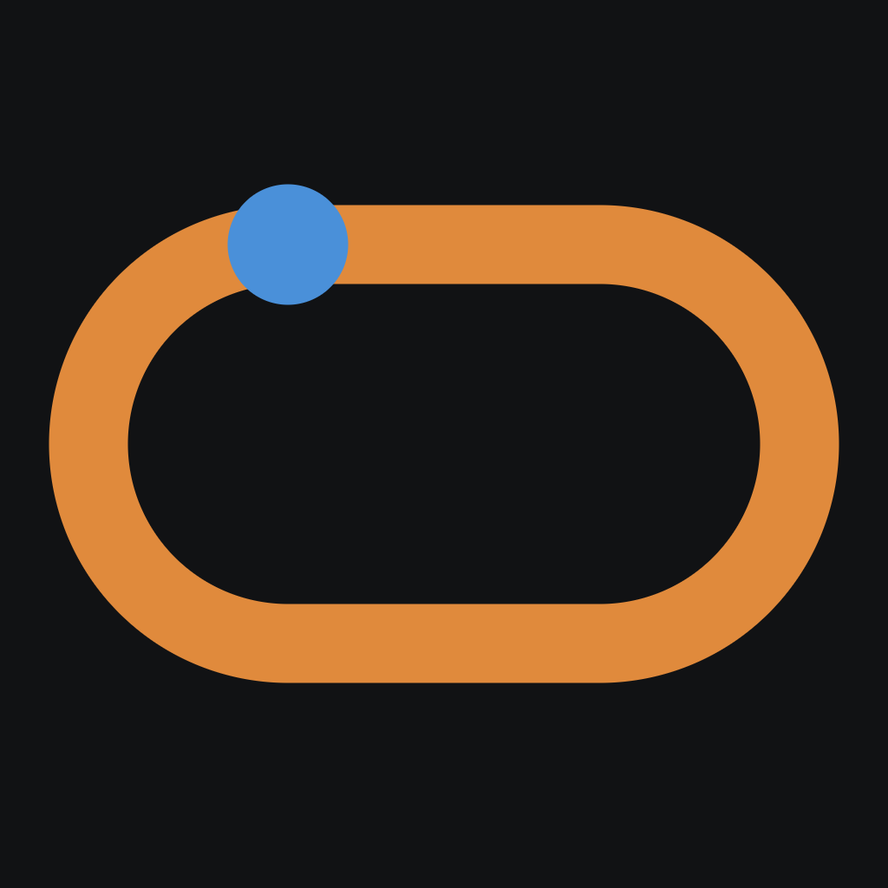
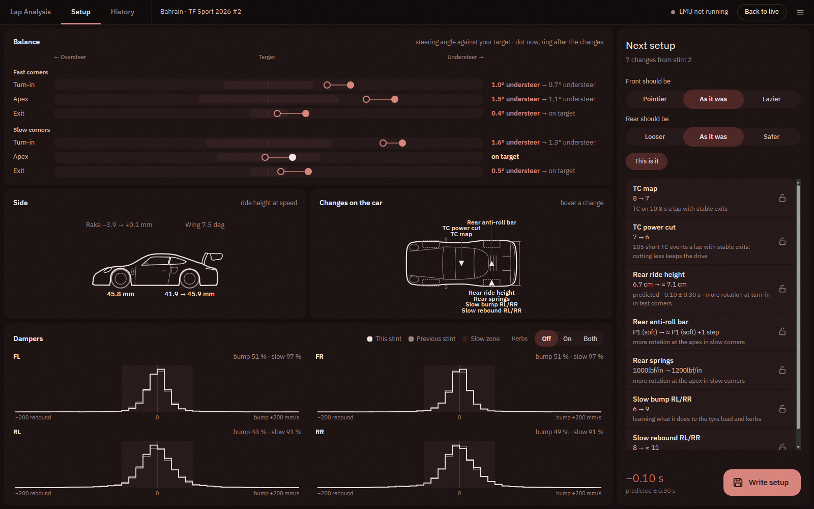
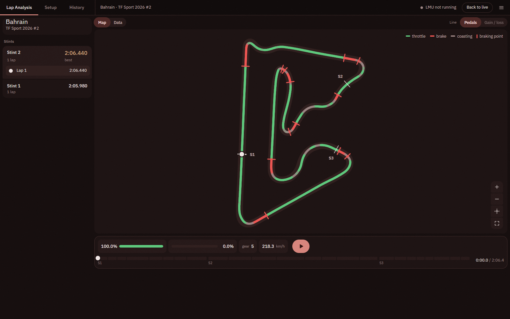

<div align="center">



# autosetup

**Setup optimiser for Le Mans Ultimate.**<br>
Drive a few laps and say how the car should feel. 


<br>

<table>
<tr>
<td></td>
<td></td>
</tr>
</table>

</div>

<br>

## Install

1. Download the installer from [Releases](https://github.com/tempora/autosetup/releases/latest) and run it (Windows 10/11; LMU through Steam is found automatically).
2. In LMU, turn telemetry recording on and drive. Stints show up when you're back in the garage.

## DAM plugin (optional)

Adds tyre load and wheel slip from the rF2 DAM MoTeC plugin.

1. Put `DAMPlugin.dll` in `<LMU>\Plugins\`.
2. With LMU closed, enable it in `<LMU>\UserData\player\CustomPluginVariables.JSON`:
   ```json
   "DAMPlugin.dll": { " Enabled": 1 }
   ```
3. Turn logging on in the plugin. `<LMU>\DAMPlugin_Output.txt` should say `Active on startup = true`.

Logs in `<LMU>\LOG\` are matched to your stints automatically.
